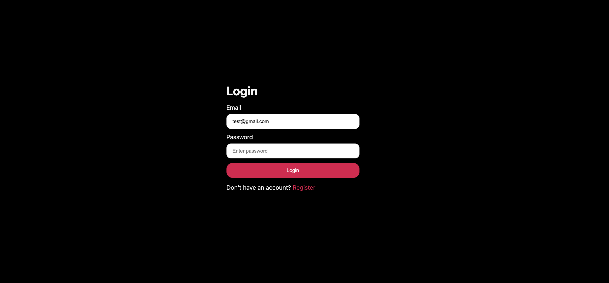
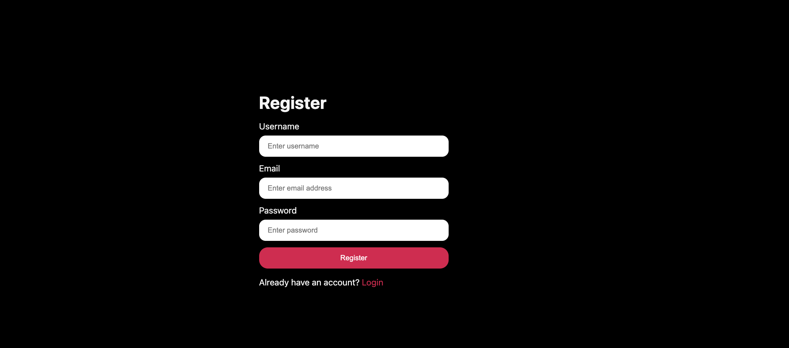
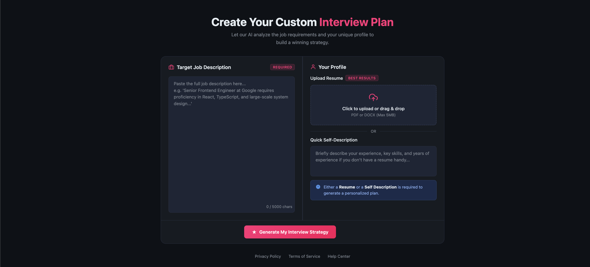
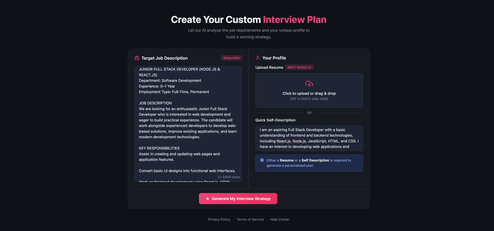
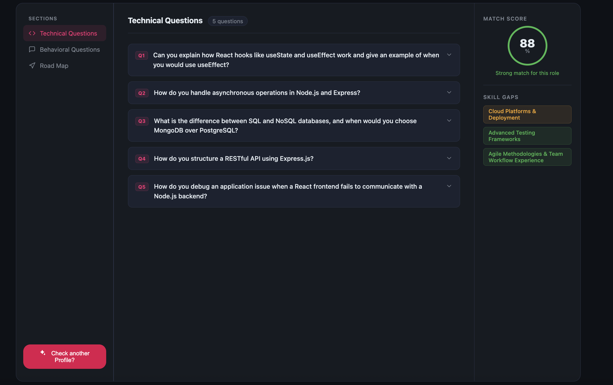
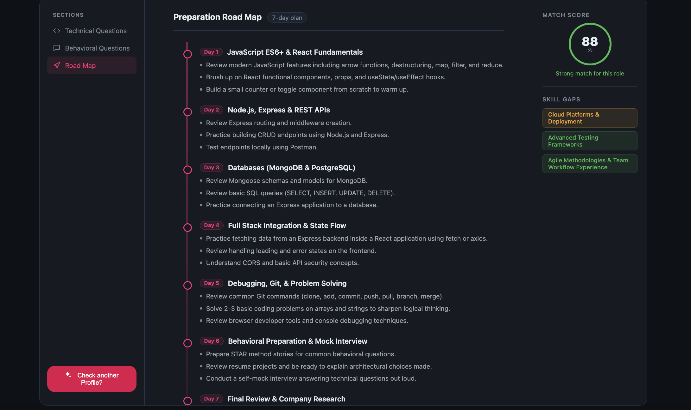

# Interview AI – AI-Powered Interview Preparation Platform

Interview AI analyzes a candidate's resume or self-description against a target job description and generates a personalized interview preparation report.

Built with **React, Node.js, Express, MongoDB, and Google Gemini AI**, it helps candidates understand their strengths, identify skill gaps, and prepare for their target roles.


---

## Screenshots

### Login Page



### Register Page



### Resume and Job Description Upload




### Interview Preparation Report



### Preparation Plan



---

## Features

- **User authentication:** Register, log in, and log out.
- **Resume analysis:** Upload a PDF resume or provide a written self-description.
- **Job description analysis:** Compare candidate experience and skills with a target role.
- **AI match score:** Estimate how closely a candidate's profile matches job requirements.
- **Technical interview questions:** Get role-specific questions, interviewer intent, and answer guidance.
- **Behavioral interview questions:** Practice behavioral questions with explanations and answer guidance.
- **Skill gap analysis:** Identify weaker or missing skills and categorize their severity as low, medium, or high.
- **Seven-day preparation plan:** Follow a personalized, day-by-day interview preparation roadmap.
- **Saved reports:** Store reports in MongoDB and revisit them later.

## How It Works

1. Create an account or log in.
2. Upload a PDF resume or enter a written self-description.
3. Provide the target job description.
4. The backend extracts text from the PDF using `pdf-parse`.
5. Google Gemini analyzes the candidate's profile against the job requirements.
6. Zod validates the generated structured response.
7. The report is saved in MongoDB and displayed in the app.


## AI-Generated Interview Report

| Section | Description |
| --- | --- |
| Match score | Estimates how closely the candidate matches the target job. |
| Technical questions | Role-specific questions with interviewer intent and answer guidance. |
| Behavioral questions | Behavioral questions with suggested answering approaches. |
| Skill gaps | Highlights missing skills and their severity. |
| Preparation plan | A personalized seven-day interview preparation roadmap. |

## Tech Stack

### Frontend

- React and Vite
- React Router
- Axios
- Sass

### Backend

- Node.js and Express
- MongoDB and Mongoose
- JWT and cookie-based authentication
- Multer for file uploads

### AI and PDF Processing

- Google Gemini through `@google/genai`
- Zod for response validation
- `pdf-parse` for extracting text from PDF resumes


## Project Structure

```text
interview-ai/
├── Backend/
│   ├── src/
│   │   ├── controllers/
│   │   ├── database.js
│   │   ├── middleware/
│   │   ├── modals/          # Mongoose models
│   │   ├── routes/
│   │   └── services/
│   ├── app.js
│   ├── server.js
│   └── package.json
├── Frontend/
│   ├── src/
│   │   ├── features/interview/
│   │   ├── app.routes.jsx
│   │   └── App.jsx
│   └── package.json
├── screenshots/             # Add app screenshots here
├── .gitignore
└── README.md
```

## Prerequisites

- Node.js and npm
- A MongoDB database (local or MongoDB Atlas)
- A Google Gemini API key

## Getting Started

### 1. Clone the repository

```bash
git clone YOUR_GITHUB_REPOSITORY_URL
cd interview-ai
```

### 2. Configure and start the backend

```bash
cd Backend
npm install
```

Create a `Backend/.env` file with your own credentials:

```env
MONGO_URI=your_mongodb_connection_string
JWT_SECRET=your_long_random_secret
GEMINI_API_KEY=your_gemini_api_key
```

Start the API:

```bash
npm run dev
```

The backend listens on `http://localhost:3003`.

### 3. Configure and start the frontend

Open a second terminal from the repository root:

```bash
cd Frontend
npm install
npm run dev
```

Open the local URL printed by Vite, usually `http://localhost:5173`. The frontend currently calls the API at `http://localhost:3003`, and the backend allows requests from `http://localhost:5173`.

## Available Commands

### Frontend (`Frontend/`)

| Command | Description |
| --- | --- |
| `npm run dev` | Start the frontend development server. |
| `npm run build` | Create a production build. |
| `npm run preview` | Preview the production build locally. |
| `npm run lint` | Run ESLint. |

### Backend (`Backend/`)

| Command | Description |
| --- | --- |
| `npm run dev` | Start the backend using Nodemon. |
| `npm start` | Start the backend using Node.js. |

## API Overview

### Authentication Routes

| Method | Endpoint | Description |
| --- | --- | --- |
| `POST` | `/api/auth/register` | Register a new user. |
| `POST` | `/api/auth/login` | Authenticate an existing user. |
| `GET` | `/api/auth/logout` | Log out and clear the session cookie. |
| `GET` | `/api/auth/get-me` | Retrieve the authenticated user. |

### Interview Routes

| Method | Endpoint | Description |
| --- | --- | --- |
| `POST` | `/api/interview/` | Generate a personalized interview report. |
| `GET` | `/api/interview/` | Retrieve the authenticated user's reports. |
| `GET` | `/api/interview/report/:interviewId` | Retrieve a specific report. |

Interview routes require authentication. Report generation uses multipart form data with `jobDescription`, optional `selfDescription`

## Environment Variables and Secrets

Keep credentials in `Backend/.env`. Do not commit real MongoDB connection strings, JWT secrets, or API keys. Ensure `.env` is listed in `.gitignore`; share only placeholder values in any example environment file.


## Future Improvements

- Add DOCX resume parsing.
- Add AI-powered mock interview simulation and real-time feedback.
- Expand resume analysis and report customization.
- Add production deployment configuration.

## Author

Developed as a full-stack, AI-powered interview preparation project.
